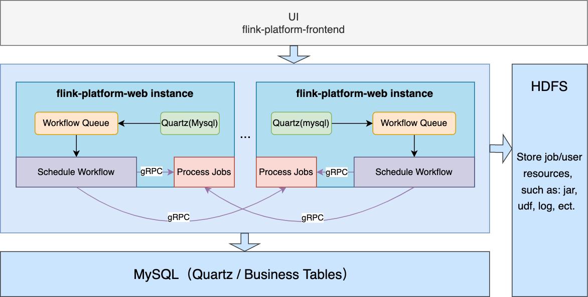

# Architecture

> The system is decentralized, all nodes are worker nodes.

## Architecture Description

### Scheduling Component

The entire scheduling component is based on Quartz(job-store = MySQL). Users set the scheduling cron
for workflows through the UI. When a trigger fires, `com.flink.platform.web.quartz.JobFlowRunner`
creates a `JobFlowRun` row (assigned to a worker via its `host` column) and persists it in a
non-terminal state — it is not handed to any in-memory queue. Each node's
`com.flink.platform.web.runner.FlowRunDispatcher.drainAndExecute` then polls MySQL every few seconds
for the non-terminal runs it owns (ordered by priority, bounded by free executor slots) and
dispatches each to a `FlowExecuteThread` for execution.

## Data storage

MySQL stores job definitions, users, schedules, execution state, and other metadata. Uploaded
resources use the configured local, HDFS, or S3 storage backend.

### Fault Tolerance

The scheduler uses MySQL rather than a separate coordination service such as ZooKeeper. Persisted
non-terminal runs are recovered by polling: after a worker restarts,
`FlowRunDispatcher.drainAndExecute` queries the rows whose `host` points to that worker, so no
dedicated in-memory reload step is needed.

When a node dies, its unfinished workflows are migrated automatically:
`com.flink.platform.web.lifecycle.WorkerHeartbeat.reassignOrphans` (guarded by ShedLock) detects
workers whose heartbeat has gone stale and rewrites the `host` of their non-terminal `t_job_flow_run`
rows to a healthy worker in the same workspace; that worker's `drainAndExecute` then picks the runs
up. If the old node is still alive, its orchestration loop notices the `host` change and abandons
the flow. This is not full execution fencing: an already-submitted external application or local
process may overlap with the new owner during a partition. Submit idempotency, executor self-fencing,
and stronger lease semantics remain tracked under **Failover Hardening** in `TODO.md`.
