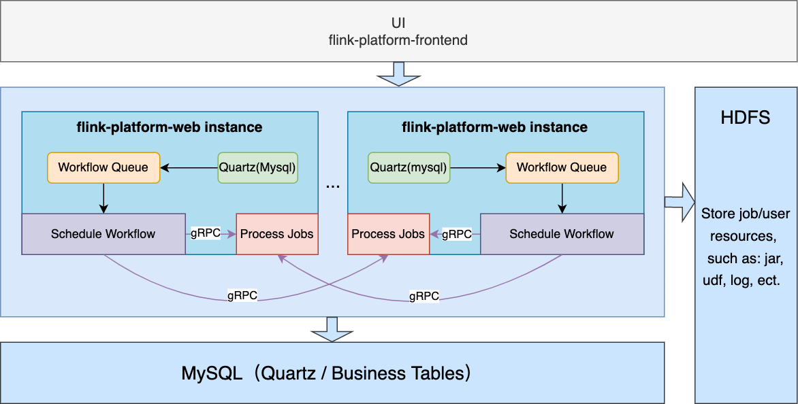

# Architecture

> The system is decentralized, all nodes are worker nodes.

## Code entry points

| Change area                             | Start in source                                                                                                                                                  | Follow through                                                                                                                     |
|-----------------------------------------|------------------------------------------------------------------------------------------------------------------------------------------------------------------|------------------------------------------------------------------------------------------------------------------------------------|
| Workflow definitions and manual runs    | [JobFlowController](../flink-platform-web/src/main/java/com/flink/platform/web/controller/JobFlowController.java)                                                | `JobFlowService`, `FlowScheduleService`, `QuartzService`                                                                           |
| Workflow graph model                    | [JobFlowDag](../flink-platform-dao/src/main/java/com/flink/platform/dao/entity/JobFlowDag.java)                                                                  | [DAG](../flink-platform-common/src/main/java/com/flink/platform/common/graph/DAG.java), `JobVertex`, `JobEdge`, `JobFlowDagHelper` |
| Scheduled run creation                  | [JobFlowRunner](../flink-platform-web/src/main/java/com/flink/platform/web/quartz/JobFlowRunner.java)                                                            | `FlowRunTriggerService`, `FlowRunCreationService`, `LegacyJobListService`                                                          |
| Waiting and DAG execution               | [FlowRunDispatcher](../flink-platform-web/src/main/java/com/flink/platform/web/runner/FlowRunDispatcher.java)                                                    | `FlowExecuteThread`, `JobExecuteThread`, `JobGrpcClient`                                                                           |
| Job submission                          | [JobGrpcServer](../flink-platform-web/src/main/java/com/flink/platform/web/grpc/JobGrpcServer.java)                                                              | `ProcessJobService`, `CommandBuilder` and `CommandExecutor` implementations                                                        |
| Worker ownership and recovery           | [WorkerHeartbeat](../flink-platform-web/src/main/java/com/flink/platform/web/lifecycle/WorkerHeartbeat.java)                                                     | `JobFlowRunService`, `FlowRunDispatcher`                                                                                           |
| API authentication and workspace access | [LoginInterceptor](../flink-platform-web/src/main/java/com/flink/platform/web/config/interceptor/LoginInterceptor.java)                                          | `PermissionInterceptor`, `RequestContext`, `WorkspaceTenantLineHandler`                                                            |
| Persistence contract                    | [entities](../flink-platform-dao/src/main/java/com/flink/platform/dao/entity/) and [mappers](../flink-platform-dao/src/main/java/com/flink/platform/dao/mapper/) | DAO services, [schema](sql/schema.sql), [migrations](sql/migration.sql)                                                            |

These are navigation pointers, not an exhaustive call graph. Trace the relevant caller and current
source before changing a contract.

## Scheduling and execution

`JobFlowController` starts and stops workflow schedules and accepts one-off runs.
`FlowScheduleService` manages Quartz registration and wait deadlines. `FlowRunCreationService`
owns run creation: it snapshots the definition and execution configuration into a `JobFlowRun`,
locks the definition, evaluates conflicts and expired waits, and inserts the run. Quartz stores its
jobs in MySQL; when a trigger fires, `JobFlowRunner` and sub-flow commands (`FlowCommandExecutor`)
call `FlowRunTriggerService`, which creates the run and then publishes its timeout and blocked
alerts. There is no in-memory handoff queue.

Each worker's `FlowRunDispatcher.drainAndExecute` polls for its non-terminal runs, ordered by
priority and bounded by available executor slots. It advances waiting runs and dispatches
eligible ones to `FlowExecuteThread`. That thread drives the DAG and starts `JobExecuteThread`
for each runnable job. `JobExecuteThread` calls the selected worker through `JobGrpcClient` and
`JobGrpcServer`. `ProcessJobService` selects the `CommandBuilder` and `CommandExecutor` for the
job type. State is stored in `t_job_flow_run` and `t_job_run`.

### API and workspace boundary

The web module serves REST controllers and a gRPC server. For normal authenticated API requests,
`LoginInterceptor` authenticates the user and reads `X-Workspace-Id` into `RequestContext`;
`PermissionInterceptor` evaluates `@RequirePermission`. MyBatis-Plus uses
`WorkspaceTenantLineHandler` to add `workspace_id` filtering to entities marked with `@TenantId`
while a workspace is present in the request context. Background scheduling and execution do not
inherit an HTTP request context; follow their explicit workspace identifiers when changing data
access. An API or schema change must account for both request-driven and background paths.

## Data storage

MySQL stores job definitions, users, schedules, execution state, and other metadata. Uploaded
resources use the configured local, HDFS, or S3 storage backend.

## Fault tolerance

The scheduler uses MySQL rather than a separate coordination service such as ZooKeeper. Persisted
non-terminal runs are recovered by polling: after a worker restarts,
`FlowRunDispatcher.drainAndExecute` queries the rows whose `host` points to that worker, so no
dedicated in-memory reload step is needed.

When a node dies, its unfinished workflows are migrated automatically:
`com.flink.platform.web.lifecycle.WorkerHeartbeat.reassignOrphans` (guarded by ShedLock) detects
workers whose heartbeat has gone stale and rewrites the `host` of their non-terminal `t_job_flow_run`
rows to a healthy worker in the same workspace; that worker's `drainAndExecute` then picks the runs
up. If the old node is still alive, its orchestration loop notices the `host` change and abandons
the flow. This is not full execution fencing: an already-submitted external application or local
process may overlap with the new owner during a partition. Submit idempotency, executor self-fencing,
and stronger lease semantics remain tracked under **Failover Hardening** in [TODO.md](../TODO.md).
