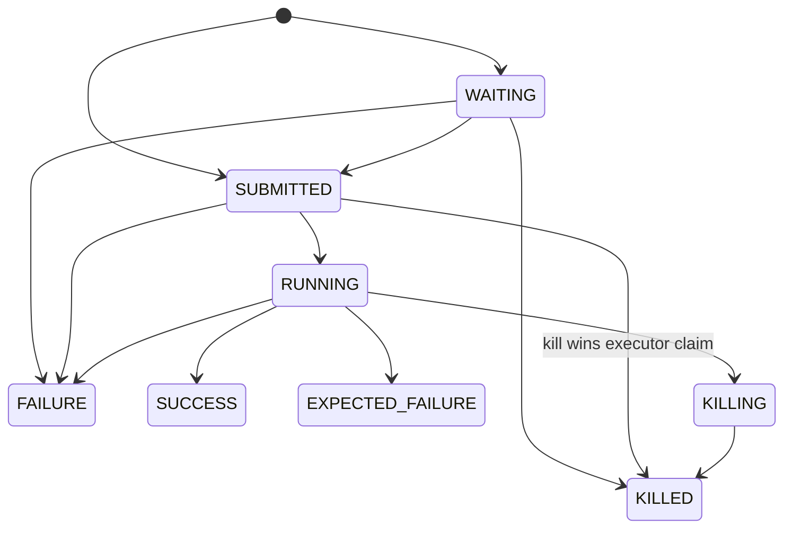

# Flow-Run State Machine and Distributed Transition Arbitration

> **简化中文评审版：**
> [flow-run-state-machine.zh-CN.md](flow-run-state-machine.zh-CN.md)
>
> **Status:** Historical design. The implemented contract and rollout notes are in
> [flow-run-state-machine-migration.md](flow-run-state-machine-migration.md). The creation path
> follows [single-phase flow-run creation](flow-run-single-phase-creation.md).
>
> **Scope:** lifecycle state changes for non-`JOB_LIST` rows in `t_job_flow_run`. `JOB_LIST` remains
> an explicit legacy compatibility path until its production definitions have migrated. A minimal
> job-run launch/kill fence is included only where flow-level kill correctness requires it; a full
> job-run state-machine migration remains separate work.
>
> This design complements
> [logical-flow-runs-and-dependencies.md](logical-flow-runs-and-dependencies.md), which defines
> logical-run and admission semantics. It replaces scattered flow-run status writes with one
> distributed transition protocol.

## Why this design exists

At the time of this design, flow-run state was written by several independent components:

| Writer | Representative transitions | Current mechanism |
|---|---|---|
| `FlowRunCreationService` | `WAITING → FAILURE` | Conditional update during admission |
| `FlowRunCoordinator` | `WAITING → SUBMITTED/FAILURE` | Conditional update |
| `KillJobService` | non-terminal → `KILLING/KILLED` | Unconditional update in important paths |
| `FlowExecuteThread` | `SUBMITTED → RUNNING`, `RUNNING → terminal` | Unconditional update |
| `FlowRunCoordinator#failAndUpdateJobFlowRun` | executable → `FAILURE` | Unconditional update |
| Generic flow-run update API | partial entity update | Status ownership is not explicit at the boundary |

The database already provides the essential distributed primitive:

```sql
UPDATE t_job_flow_run
SET status = :target
WHERE id = :id
  AND status IN (:expected_statuses);
```

Only one concurrent writer can update the row from the expected state. The missing piece is a
single domain contract for interpreting the result. Today each caller decides independently what
zero updated rows mean. That produces three problems:

1. a new writer adds new pairwise race handling to every existing writer;
2. unconditional writes can overwrite `KILLING`, `KILLED`, or an already committed terminal result;
3. retry loops and alert decisions are spread across scheduler, dispatcher, kill, and executor code.

The state machine must make every transition explicit, distributed-safe, bounded, and observable.

## Goals

- Make the database the only distributed transition arbiter; no JVM-local lock or in-memory leader.
- Centralize legal flow-run transitions and their timestamp side effects.
- Give kill intent priority over all normal **uncommitted** execution progress.
- Preserve an already committed terminal outcome; a late kill must not rewrite `SUCCESS` or
  `FAILURE` to `KILLED`.
- Make repeated kill requests and duplicate callbacks idempotent.
- Remove unbounded reconciliation loops from admission and lifecycle code.
- Ensure only the transition winner publishes terminal alerts or external side effects.
- Use SQL and transaction semantics supported by both MySQL and PostgreSQL.
- Avoid a schema migration in the first implementation phase.

## Non-goals

- Event sourcing or a complete persisted transition-history table.
- Replacing Quartz, the dispatcher, or the current executor architecture.
- Giving terminal states a total business ranking; `SUCCESS` is not "higher" or "lower" than
  `KILLED` after either one has committed.
- Reusing the same database row for retries. Retry attempts remain separate rows as specified by
  the logical-run design.
- Making external process termination transactional with the database. The design coordinates it
  through durable intent and idempotent reconciliation instead.
- Migrating the complete `t_job_run` lifecycle. This delivery adds only the durable start/kill
  boundary needed to prevent a child resource from starting after its parent enters `KILLING`.
- Adding lifecycle semantics to `JOB_LIST`. Existing production `JOB_LIST` definitions keep their
  isolated legacy path and are migrated independently.
- Providing exactly-once external job launch during a network partition. The first delivery fences
  flow ownership and converges cleanup, but a strict external-launch fence would require a durable
  owner generation and a later job-run state-machine design.

## Core invariants

1. **Terminal states are immutable.** No automatic transition leaves a terminal state.
2. **`KILLING` is a fence.** Normal scheduling, submission, execution, and completion transitions
   cannot leave `KILLING`; only kill finalization may move it to `KILLED`.
3. **Kill wins only before terminal commit.** A successful non-terminal → kill transition owns the
   run. A kill arriving after terminal commit is rejected with the committed terminal status and
   treated as an idempotent no-op.
4. **Every write names its expected source state.** Production code must not update flow-run status
   by id alone. Execution-owner writes also name the expected host, so a reassigned worker cannot
   complete a run it no longer owns.
5. **One transition winner owns one-shot side effects.** Terminal alerts and completion publication
   occur only when the corresponding transition result is `APPLIED`. Cleanup under a durable
   `KILLING` fence is idempotent and may be retried by another worker.
6. **Retries are layered and bounded.** Each target row gets at most one CAS and one reconciliation
   read per business operation. Multi-row admission therefore remains bounded without needing a
   batch-result abstraction. Transaction-level retries belong to the outer operation, never to the
   transition primitive. Cleanup retries run asynchronously.
7. **State is durable, workers are replaceable.** A different instance can observe `KILLING` and
   continue cleanup after the original worker disappears.
8. **Kill closes the launch gate before cleanup.** A single empty job-run query is not proof that no
   resource can still start. After `KILLING` commits, no new child may be reserved or claim external
   execution. `KILLING → KILLED` occurs only after every child that crossed the launch gate is
   stopped or confirmed absent.

## Type model and legacy boundary

The lifecycle contract belongs to `t_job_flow_run`, not to one `JobFlowType`. The state core never
switches on type:

- future `FLINK`, `SPARK`, and `SQL` definitions keep `t_job_flow` and `t_job` in a 1:1 relation;
  each flow-run envelope likewise has one job run;
- the current `JOB_FLOW`, later renamed `FLOW`, is the composite exception: one flow definition
  references multiple jobs and one flow-run envelope has multiple job runs;
- type-specific execution adapters decide how children are created and how their results aggregate;
- `JOB_LIST` alone is routed around the new lifecycle contract while production users migrate.

Keeping the legacy branch at the caller boundary means the state core remains valid when
`JOB_FLOW` becomes `FLOW` and when new one-to-one execution types are added. No new lifecycle code
may depend on `JOB_LIST`, and no new feature is added to its compatibility path.

## State model

New flow runs are inserted with a complete snapshot in `WAITING` or `SUBMITTED`. `CREATED` remains
in `ExecutionStatus` for job runs and may occur in legacy flow-run rows, but no new flow-run
admission produces it. Deprecated and job-only values are not new transition targets.



### Transition matrix

| From | Allowed target | Owner / reason |
|---|---|---|
| `WAITING` | `SUBMITTED` | Dependencies satisfied |
| `WAITING` | `FAILURE` | Dependency timeout, unsatisfied status, or invalid configuration |
| `WAITING` | `KILLED` | Kill while no execution resources exist |
| `SUBMITTED` | `RUNNING` | Executor successfully claims the run |
| `SUBMITTED` | `FAILURE` | Submission cannot start, for example no runnable vertex |
| `SUBMITTED` | `KILLED` | Kill wins the CAS before execution starts |
| `RUNNING` | `SUCCESS`, `FAILURE`, `EXPECTED_FAILURE` | Normal execution completion |
| `RUNNING` | `KILLING` | Kill requests external cleanup |
| `KILLING` | `KILLED` | External resources stopped or confirmed absent |

All other transitions are invalid unless a future design explicitly adds them. In particular:

- `KILLING → RUNNING/SUCCESS/FAILURE` is forbidden;
- `SUBMITTED → SUCCESS/EXPECTED_FAILURE` is forbidden because execution must claim `RUNNING`
  before it can produce a business result;
- terminal → any state is forbidden;
- retry does not move a terminal row back to an active state;
- a late kill never changes `SUCCESS`, `FAILURE`, or `EXPECTED_FAILURE` to `KILLED`.

## Kill semantics

Kill is high-priority **intent**, not last-write-wins status overwriting.

### No execution resources: direct terminal kill

`WAITING` has no submitted/running infrastructure. A kill request transitions it directly to
`KILLED` and sets `end_time` in the same conditional update.
Legacy flow-run `CREATED` rows can also be killed directly; they are never activated.

### Possible execution resources: fenced cleanup

`SUBMITTED` is a claim boundary: the executor must win `SUBMITTED → RUNNING` before creating
execution resources. A kill competing with that claim requests `SUBMITTED → KILLED`; whichever CAS
wins owns the next action.

When a run is already `RUNNING` and resources may exist, it transitions to `KILLING` first:

1. atomically claim kill intent with a conditional status update;
2. commit the `KILLING` state;
3. request local or remote infrastructure termination outside that transaction;
4. after cleanup succeeds or the resource is confirmed absent, transition `KILLING → KILLED`;
5. if cleanup fails, leave the durable state at `KILLING` and retry through reconciliation.

Once `KILLING` commits, executor completion callbacks cannot publish a normal terminal result.
Repeated kill requests return an idempotent "already killing" result and may trigger another safe
cleanup attempt.

The request path does not finalize `KILLED` merely because its first job-run query is empty. Child
reservation and external launch use two durable gates:

1. a short transaction locks the parent flow-run row, verifies `RUNNING` and the expected host, and
   then creates or reuses the child job run;
2. before starting an external command, the child job run must win its own conditional launch
   claim; job kill competes with that claim.

If reservation commits first, the child is durably visible before flow kill can commit `KILLING`.
If flow kill commits first, reservation observes `KILLING` and creates nothing. Cleanup finalizes
the parent only after every visible child has lost or completed its launch claim and its external
resource is stopped or absent. The detailed job-run edges are specified in the later launch-fence
task rather than expanding this document into a second full state machine.

Host reassignment is itself conditional on the old host and a non-terminal state. A stale executor
therefore cannot complete the flow after reassignment because its completion CAS includes the old
host. The launch gate and host predicate prevent new owned work after the fence without adding an
owner-generation column; the new owner continues idempotent cleanup before finalizing `KILLED`.

`SUBMITTED → KILLED` is safe because the executor cannot create resources until its competing
`SUBMITTED → RUNNING` transition succeeds. A `RUNNING` run must first enter `KILLING` to close the
launch gate, even when cleanup appears trivial. `confirmKilled` accepts only `KILLING` after cleanup
has completed or resource absence is confirmed.

### Completion versus kill

Completion and kill compete using the same database CAS:

```text
executor: RUNNING → SUCCESS
kill:     RUNNING → KILLING
```

- if `SUCCESS` commits first, kill is `REJECTED` with observed status `SUCCESS` and becomes an
  idempotent no-op;
- if `KILLING` commits first, executor completion is `REJECTED` with observed status `KILLING` and
  emits no success alert;
- neither path overwrites the winner.

This rule matches the user-visible meaning: kill stops unfinished work, but does not rewrite
history after work has already completed.

### Industry reference points

- [Temporal](https://docs.temporal.io/develop/java/cancellation) separates cooperative
  cancellation from immediate termination and records the chosen outcome in durable workflow
  history.
- [Prefect](https://docs.prefect.io/v3/advanced/cancel-workflows) uses
  `CANCELLING → CANCELLED`: a worker first stops infrastructure, and a server-side timeout provides
  a recovery safety net.
- [Kubernetes](https://kubernetes.io/docs/concepts/overview/working-with-objects/finalizers/)
  records deletion intent before cleanup and prevents an object pending deletion from returning to
  normal operation; finalizers complete cleanup before removal.

The shared pattern is durable stop intent followed by fenced cleanup, not an unconditional final
status overwrite.

## Architecture

### Package and dependency boundary

Flow-run lifecycle code leaves the flat `web.service` package and is grouped by domain:

```text
com.flink.platform.web.flowrun
├── FlowRunStateService
├── FlowRunTransition
├── FlowRunAdmissionService
└── FlowRunKillService
```

`FlowRunStateService` owns legal transitions and result interpretation. Admission and kill services
own business orchestration and external effects. Existing Quartz, controller, dispatcher, and
executor classes call into this package; they do not implement transition policy themselves. DAO
primitives remain in `flink-platform-dao`.
`WorkerHeartbeat` owns orphan host reassignment and calls the DAO's conditional host update directly;
host reassignment does not change the flow-run lifecycle status.

The package name deliberately describes the domain rather than the implementation technique. A
later full job-run lifecycle redesign may choose its own boundary; this delivery does not create a
parallel package merely for symmetry.

`JOB_LIST` routing happens before this package is entered. Its legacy branch remains isolated in
existing compatibility code and is excluded from the architectural enforcement rule until those
production definitions have migrated.

### Persistence primitives: `JobFlowRunService`

The DAO service remains responsible only for atomic conditional updates and lightweight reads. It
must not decide whether a transition is legal for a business operation.

Required primitives:

```java
int updateStatusFromAnyTo(
        Long flowRunId,
        Set<ExecutionStatus> expectedStatuses,
        @Nullable String expectedHost,
        ExecutionStatus target);

int updateHostsIfOwnedBy(
        Collection<Long> flowRunIds,
        String expectedHost,
        String targetHost,
        Set<ExecutionStatus> expectedStatuses);

@Nullable JobFlowRun findState(Long flowRunId);
```

`expectedHost` is nullable for admission and global kill operations. Execution claim,
recovery-sensitive completion, executor-originated kill, and host reassignment provide it. The SQL
omits the host predicate only when the domain operation deliberately has no owner requirement.

`updateHostsIfOwnedBy` changes only candidate rows still assigned to the observed dead host and
remaining non-terminal. `WorkerHeartbeat` groups candidates by target host and updates bounded
chunks. The returned count records how many rows changed; no per-run side effect depends on knowing
which candidates won. Host reassignment changes no lifecycle status or timestamps.

`findState` selects only status, host, and lifecycle timestamps. It returns null only when the row
does not exist; unlike the existing best-effort recovery read, it must propagate database failures
so callers never misclassify an infrastructure error as `NOT_FOUND`.

`FlowRunCreationService` inserts the complete candidate snapshot and its initial `WAITING` or
`SUBMITTED` status in one admission transaction. A blocked candidate is not inserted. This is a
creation operation, not a lifecycle transition from a placeholder row.

The update sets state-owned timestamps in the same SQL statement:

- entering `RUNNING` sets `start_time` if absent;
- entering a terminal state sets `end_time`;
- entering `KILLING` does not set `end_time`;
- unrelated entity fields are not accepted by this primitive.

The exact method names may follow repository DAO naming conventions during implementation. The
contract is the important part: expected state is always part of the `UPDATE` predicate.

### Domain arbiter: `FlowRunStateService`

`FlowRunStateService` is a stateless Spring service available on every application instance. It
does not own a distributed lock. Public domain methods encode legal transitions; callers cannot
freely combine source and target values.

The following API is illustrative. Exact signatures, file placement, and test fixtures are decided
and reviewed in the corresponding implementation task; the named business operations are the
stable design contract:

```java
TransitionResult submitWaiting(long flowRunId);
TransitionResult failWaiting(long flowRunId);
TransitionResult startExecution(long flowRunId, String workerHost);
TransitionResult completeExecution(
        long flowRunId, String workerHost, ExecutionStatus finalStatus);
TransitionResult requestKill(long flowRunId);
TransitionResult requestKill(long flowRunId, String workerHost);
TransitionResult confirmKilled(long flowRunId);
TransitionResult forceKilled(long flowRunId);

record TransitionResult(
        TransitionOutcome outcome,
        @Nullable ExecutionStatus status) {}

enum TransitionOutcome {
    APPLIED,
    REJECTED,
    NOT_FOUND
}
```

The three low-level outcomes are intentionally small:

| Outcome | Meaning | Caller action |
|---|---|---|
| `APPLIED` | Conditional update changed exactly one row; `status` is the committed target | Perform winner-only side effects |
| `REJECTED` | Another state committed first; `status` is the reconciled observation | Interpret the committed state through shared helpers |
| `NOT_FOUND` | The run no longer exists; `status` is null | Fail the operation explicitly |

The flow-run id and requested target are already method arguments, so duplicating them in the result
adds ceremony without information. `REJECTED` is interpreted without more enum values:

- `status == requested target`: already applied; treat as idempotent success only for operations
  documented as repeatable;
- `status.isTerminalState()`: preserve the terminal winner;
- another non-terminal status: the request was superseded and the domain operation decides
  whether to block, reconcile, or retry cleanup.

An invalid method argument, such as completing execution with `KILLED`, is a programming error and
throws before SQL. It is not a runtime outcome.

The reconciled `status` is diagnostic, not a linearizable snapshot of the CAS failure instant.
MySQL does not provide a portable `UPDATE ... RETURNING` equivalent. After an update count of zero,
the service performs one lightweight read. Another valid forward transition may already have
happened; terminal immutability and the `KILLING` fence keep that observation safe to interpret.
Method names provide the operation category for logs and metrics; detailed failure or alert reasons
remain caller data and do not require another public cause type.

`requestKill` is the one operation whose target depends on the current source. It performs one
lightweight state read, chooses direct `KILLED` for `WAITING/SUBMITTED` (and legacy `CREATED` rows)
or `KILLING` for `RUNNING`, and then performs one CAS. The direct-kill CAS accepts any of the three
pre-execution statuses, so `WAITING → SUBMITTED` between the read and update does not reject the
kill. A contention miss gets one reconciliation read; it never tries several target transitions in
sequence.
The kill orchestration layer may make one fresh request when the first CAS loses to another
non-terminal status. Each request still follows the single-CAS contract; a terminal winner or
`KILLING` ends the attempt without another transition.
The worker-host overload accepts only `RUNNING → KILLING` while that worker still owns the run. It
never falls back to the host-agnostic overload after a rejected CAS.

`confirmKilled` is used by cleanup code after the launch gate is closed and resources are verified.
The separate `forceKilled` operation is an audited operator assertion that the same
verification was performed out of band. Both may move a non-terminal row to `KILLED`, but neither
may rewrite an existing terminal result.

## Distributed behavior

The service is safe in a centerless multi-instance deployment because every instance executes the
same conditional SQL against the shared database:

```text
instance A ─┐
            ├─ UPDATE ... WHERE status IN (...) ─→ one winner
instance B ─┘
```

The database serializes updates to the same row and rechecks the status predicate after waiting
for a concurrent transaction. No local `synchronized`, leader election, or distributed cache is
part of correctness.

The SQL shape works in MySQL and PostgreSQL. The implementation must not rely on PostgreSQL-only
`RETURNING`, MySQL gap-lock behaviour, or a database-specific affected-row option. Tests assert
that a real state change reports one updated row and a predicate miss reports zero.

Status arbitration and execution ownership are related but distinct:

- `SUBMITTED → RUNNING` is the first-start claim and only `APPLIED` may start new flow execution;
- a dispatcher may resume an existing `RUNNING` row only when its persisted host is the local host;
- resume is not represented as `RUNNING → RUNNING` and never masquerades as a transition winner;
- completion requires both `status = RUNNING` and `host = localHost`;
- orphan reassignment updates the host only when `host = deadHost` and the status remains
  non-terminal.

This preserves the current in-place recovery behaviour without adding a new status or schema field,
while preventing the previous owner from committing a terminal result after reassignment.

## Retry policy

Three retry mechanisms serve different failures and must not be mixed:

1. **Expected state contention:** one CAS and at most one reconciliation read per target row. A
   rejected CAS is normal coordination, not a system error. The active-run set is deliberately
   small, so the first delivery favours this simple bounded contract over a batch-result abstraction.
2. **Transient database failure:** deadlock, serialization failure, or a retryable connection error
   allows at most three total transaction attempts (the initial attempt plus two retries) with a
   small jittered backoff. The outer business operation owns this retry so each attempt starts a new
   transaction and rereads state. `FlowRunStateService` itself never retries a caller transaction or
   repeats external effects. Business rejection is never retried by this layer.
3. **External kill cleanup:** durable `KILLING` work is retried asynchronously by reconciliation;
   it does not hold the request or admission transaction open.

This prevents a normal scheduler/dispatcher race from surfacing as task failure while also avoiding
an unbounded CAS loop. After bounded reconciliation, an active winner blocks admission and a
terminal winner permits it. A Quartz occurrence surfaces a database failure only after retryable
transaction attempts are exhausted. Only an unresolved state or exhausted infrastructure failure
is a system error.

## Bounded admission reconciliation

`FlowRunCreationService#tryCreateFlowRun` keeps the flow-definition row lock because it serializes
creation of runs for one flow across scheduler nodes. The current implementation already has no
unbounded loop; the migration replaces its CAS-loss exception with bounded reconciliation.

The bounded algorithm is:

1. lock the `t_job_flow` definition row;
2. read the active run snapshot;
3. apply the existing conflict policy to non-expired active runs;
4. request `WAITING → FAILURE` for every expired wait through `FlowRunStateService`;
5. if any transition does not apply, read active runs once more and apply the conflict policy again;
6. block the candidate if the fresh set conflicts; otherwise insert it with initial status
   `WAITING` or `SUBMITTED`;
7. commit; publish timeout alerts only for applied transitions and report a blocked outcome.

There is one CAS pass across the target rows and at most one fresh active-run query for the
admission decision. Per-row transition results may each perform their bounded diagnostic read; no
path spins until external state changes.

### Sub-flow candidates

Sub-flow triggers use the same admission transaction as cron and manual triggers. A conflict
returns `BLOCKED` without inserting a row; success inserts the complete child run and returns its
id and initial status to the parent callback.

## Call-site migration

### `FlowRunCoordinator`

- `WAITING → SUBMITTED` uses the transition service.
- Dependency failure and timeout use `WAITING → FAILURE`.
- Only `APPLIED` sends the corresponding terminal alert.
- A loser does not retry locally; the observed owner is already responsible for the run.
- Batch submission may retain a conditional batch update when only the count is needed, but it
  must preserve the same expected-state predicate and must not publish per-run winner effects.

### `KillJobService`

- Replace unconditional `updateStatusById` calls.
- `WAITING → KILLED` completes immediately; legacy `CREATED` rows may also be killed directly.
- `SUBMITTED → KILLED` competes atomically with the executor's `SUBMITTED → RUNNING` claim.
- `requestKill` uses `RUNNING → KILLING`; `confirmKilled` uses `KILLING → KILLED` only after
  cleanup is confirmed.
- `KILLING` and `KILLED` are idempotent successful responses.
- Other terminal states return `REJECTED` with the committed terminal status and remain unchanged.
- Remote/local kill starts only after the kill-intent transition commits.
- The request may start best-effort cleanup but does not treat one empty job-run query as proof that
  the child-reservation and launch gates are closed.

### `FlowExecuteThread`

- Claim first execution with `SUBMITTED → RUNNING`; only `APPLIED` starts that path.
- Resume a persisted `RUNNING` row only when it is still assigned to the local host. Resume is an
  explicit caller branch, not an idempotent interpretation of a rejected start transition.
- If claim is superseded by `KILLING/KILLED`, do not start work.
- Recheck durable status and host before scheduling each new vertex; durable child reservation still
  goes through the database launch gate rather than relying on this best-effort check.
- Complete with `RUNNING → SUCCESS/FAILURE/EXPECTED_FAILURE`.
- Include the local host in the completion predicate so an old owner cannot finish a reassigned run.
- If completion is superseded by `KILLING/KILLED`, discard the normal completion and emit no
  normal terminal alert.
- Do not update status with a partial entity by id alone.

### `FlowScheduleService` and `JobFlowRunner`

- Keep the flow-row lock for cross-node admission.
- Replace boolean CAS interpretation with structured transition results.
- Replace the current CAS-loss exception with bounded reconciliation.
- A fresh candidate insert remains part of the admission transaction.
- Every accepted candidate is inserted once with its complete snapshot.
- Route `JOB_LIST` to its unchanged legacy handler before calling `web.flowrun`; all other current
  and future types use the common lifecycle contract without a type switch inside the state core.

### Generic flow-run update API

The generic update endpoint must not accept lifecycle-owned fields such as `status`, `startTime`,
or `endTime`. Administrative lifecycle operations use explicit endpoints and the transition
service. This prevents an API caller from bypassing the state machine.

The current UI uses `POST /jobFlowRun/update` with `{id, status: KILLED}` for its administrative
"Set KILLED" action. Migration is additive:

1. add an explicit audited administrative force-resolve operation that invokes
   `forceKilled` and never rewrites an already terminal outcome;
2. move the first-party UI to that operation;
3. keep the exact legacy `{id, status: KILLED}` request as a temporary compatibility adapter for one
   release, routing it to the same domain operation;
4. reject other lifecycle-owned fields immediately and remove the adapter only after deprecation.

The compatibility adapter preserves the HTTP shape but intentionally stops the old ability to
rewrite `SUCCESS` or `FAILURE` as `KILLED`.

### Failover and recovery

Any recovery component that writes flow-run status must use the same transition service. A worker
that observes `KILLING` may retry cleanup; it does not need to be the instance that accepted the
original kill request. Host reassignment remains in `WorkerHeartbeat`, but its update is conditional
on the observed dead host and a non-terminal state. A `RUNNING` row on the new host follows the
explicit resume path; a `KILLING` row follows cleanup only.

## External side effects and transaction boundaries

Database state changes are transactional; process termination, Quartz calls, and alert delivery
are not. The ordering rules are:

1. persist ownership or intent first;
2. commit;
3. perform the external side effect;
4. persist finalization with another conditional transition.

Examples:

- commit `RUNNING → KILLING`, then kill infrastructure, then commit `KILLING → KILLED`;
- commit `WAITING → FAILURE`, then send the timeout alert;
- commit `RUNNING → SUCCESS`, then send the success alert.

An external-effect failure never rolls back the already committed intent. A reconciler retries
idempotent cleanup or delivery according to that durable state. A transactional outbox may be
introduced later if exactly-once notification becomes a requirement; it is not required for the
first lifecycle phase.

## `KILLING` reconciliation

`KILLING` must not depend forever on the worker that accepted the request.

The existing dispatcher/recovery loop should eventually own a bounded reconciliation action:

1. run only on the persisted owner host, or after orphan reassignment has conditionally transferred
   that host;
2. rely on the committed parent state to reject every later child-reservation transaction;
3. make each visible child lose or complete its conditional external-launch claim;
4. inspect all admitted job/infrastructure identifiers and retry safe termination requests;
5. if every admitted child is terminal and every resource is stopped or absent, transition
   `KILLING → KILLED`;
6. if a claim, resource, or ownership change remains unresolved, retain `KILLING` and retry later;
7. repeated cleanup failure never restores normal execution.

The first implementation may reuse current force-kill paths and retry every reconciliation cycle.
It must not force `KILLED` because a timer elapsed, because the first resource query is empty, or
while known infrastructure is still running. A persistent "time spent killing" alert requires a
durable `kill_requested_at` or generic status-transition timestamp; add that schema only when the
alert is implemented.

## API semantics

Kill remains idempotent:

| Current state | API result | State effect |
|---|---|---|
| `WAITING` (or legacy `CREATED`) | accepted/completed | `KILLED` |
| `SUBMITTED` | accepted/completed if kill wins executor claim | `KILLED` |
| `RUNNING` | accepted | `KILLING` |
| `KILLING` | accepted/already in progress | none; cleanup may be retried |
| `KILLED` | success/already killed | none |
| other terminal | already terminated | none |
| missing run | not found | none |

The REST layer maps these domain outcomes to stable response codes. It does not pre-read status and
then issue an unconditional write; the transition result is the authoritative response.

## Observability

Every transition attempt should log structured fields:

```text
flowRunId, operation, expectedStatuses, expectedHost, targetStatus, outcome, status, worker
```

When a caller transaction is active, the log is emitted after commit so a rolled-back `APPLIED`
update is not reported as a durable transition.

Recommended counters:

- transitions applied by operation and target;
- rejected transitions by reconciled state;
- invalid domain-method arguments;
- transient transaction retries and exhausted retries;
- repeated `KILLING` cleanup failures;
- admission invariant violations.

Expected `REJECTED` contention is logged at debug/info level and is not counted as a task or system
failure. `NOT_FOUND` for a known run, invalid arguments, exhausted transient database retries, and
unresolved admission state are warnings or errors.

## Testing strategy

### State-matrix unit tests

Use parameterized tests for every allowed and forbidden edge. Mutation checks should prove that:

- removing the `KILLING` fence fails tests;
- allowing terminal-state exits fails tests;
- omitting expected status from SQL fails tests;
- terminal timestamp side effects are applied only by the winner.

### Caller tests

Cover at least:

- sub-flow admission inserts a complete child run or returns blocked without inserting one;
- dependency satisfaction versus wait timeout;
- wait timeout versus user kill;
- execution start versus kill;
- first execution claim versus same-host recovery resume;
- stale-host completion after orphan reassignment;
- execution completion versus kill in both commit orders;
- repeated kill while `KILLING` and after `KILLED`;
- child reservation versus parent `RUNNING → KILLING` in both commit orders;
- child launch claim versus job kill in both commit orders;
- an empty cleanup snapshot cannot finalize `KILLED` until both launch gates are closed;
- an executor callback arriving after `KILLING`;
- transition loser emits no duplicate alert;
- unresolved admission state fails fast without looping;
- expected CAS rejection is not reported as a task/system failure;
- retryable database errors allow at most three total transaction attempts;
- business rejection and non-retryable errors are never retried;
- non-`JOB_LIST` types share the same state contract while `JOB_LIST` takes only its legacy route;
- the legacy `{id, status: KILLED}` adapter reaches the audited administrative operation, while an
  already terminal non-kill result remains unchanged.

### Real-database concurrency tests

Run the same two-connection tests against MySQL and PostgreSQL Testcontainers:

1. both transactions read the same starting state;
2. release competing conditional updates simultaneously;
3. verify exactly one transition is applied;
4. verify the loser classifies the committed state correctly;
5. verify terminal states and `KILLING` cannot be overwritten;
6. verify a completion carrying the old host loses after conditional reassignment;
7. verify blocked sub-flow admission leaves no child row;
8. verify child reservation and parent kill serialize on the parent row;
9. verify admission never spins under either database's default or configured isolation policy.

Mock-only tests cannot establish transaction isolation, affected-row, or row-lock behaviour.

## Rollout plan

### Phase 1 — transition contract

- Create `web.flowrun` and add the transition matrix, compact result type, and thin
  `FlowRunStateService`.
- Add the three conditional-write persistence primitives.
- Keep the existing status column and enum values.
- Add exhaustive unit tests and MySQL/PostgreSQL CAS integration tests.
- Do not change callers until the contract is verified.

### Phase 2 — admission and dispatcher

- Migrate `FlowScheduleService` and `FlowRunCoordinator`.
- Replace admission's CAS-loss exception with one CAS pass and bounded reconciliation.
- Insert complete sub-flow candidate snapshots in the admission transaction.
- Add the bounded transaction retry wrapper for explicitly retryable database failures.
- Preserve post-commit, single-winner timeout alerts.

### Phase 3 — flow-run execution ownership

- Migrate `FlowExecuteThread` start, resume, and completion.
- Separate first-start claim from same-host `RUNNING` recovery.
- Fence completion and orphan reassignment by host.

### Phase 4 — flow-run kill intent and reconciliation

- Split flow-run kill orchestration from job-run kill implementation.
- Make flow kill idempotent and fence normal completion through `KILLING`.
- Add durable `KILLING` reconciliation, initially stopping before child launch-fence finalization.

### Phase 5 — minimal job-run launch/kill fence

- Serialize child reservation against the parent `RUNNING/KILLING` boundary.
- Make external job launch claimable and make job kill compete with that claim.
- Allow parent `KILLING → KILLED` only after every admitted child is stopped or absent.
- Do not redesign unrelated job-run retry, monitoring, or terminal aggregation semantics.

### Phase 6 — close bypasses and preserve APIs

- Deprecate unrestricted status helpers and migrate failover/recovery writers.
- Add the audited administrative force-resolve operation and move the UI to it.
- Reject lifecycle-owned fields from the generic flow-run update API, retaining only the temporary
  `{id, status: KILLED}` compatibility adapter.
- Add an architectural test or static check that production status writes occur only through the
  transition service/persistence primitive, with an explicit temporary allow-list for the isolated
  `JOB_LIST` legacy handler.

### Phase 7 — operational hardening and activation

- Add transition metrics and dashboards.
- Load-test dispatcher batch transitions.
- Decide whether persisted transition history or a transactional outbox is justified by observed
  support and delivery requirements.

## Compatibility and migration

The first six phases require no flow-run schema change and preserve existing status codes and response
shapes. API clients continue seeing `KILLING` and `KILLED`; only race outcomes become deterministic.
The intentional semantic change is that no API, including the legacy administrative adapter, may
rewrite an already committed terminal result.

MySQL and PostgreSQL use the same conditional-update contract. Database-specific schema and Quartz
configuration remain separate portability work, tracked outside this document.

Rolling deployment uses a bridge release:

1. add `worker.flow-run-lifecycle-enabled`, defaulting to `false`;
2. ship the migrated callers and both behaviours in the bridge version, with the compatibility
   branch centralised inside the state-service facade rather than duplicated across callers; while
   disabled, it delegates to the preserved legacy helpers;
3. roll the bridge version to every worker while the flag is off, so old and new binaries still use
   legacy semantics during that rollout;
4. after every worker reports the bridge version, briefly quiesce lifecycle mutations, enable the
   flag cluster-wide, verify it on every worker, and resume scheduling and kill operations;
5. keep old helper methods and the legacy administrative adapter deprecated for one release, then
   remove them only after logs show no external use.

Even after activation, `JOB_LIST` continues through its isolated legacy handler. The feature flag
selects the new lifecycle for every other supported type. Removing that exception requires a
separate production-data migration and is not a prerequisite for adding `FLINK`, `SPARK`, `SQL`, or
renaming `JOB_FLOW` to `FLOW`.

No design can enforce the new fence while an old binary is still allowed to issue unconditional
writes. The activation gate makes that limitation explicit and avoids a large API or schema
breaking change. A coordinated stop-the-world deployment remains the simpler fallback when a
cluster cannot provide the bridge flag and activation check.

## Rejected alternatives

### Put all transition policy in `JobFlowRunService`

It saves one class but mixes legal business operations with generic MyBatis CRUD and makes the
low-level target/source API the natural caller surface. The chosen design is the minimum useful
separation: one thin domain service and three conditional-write primitives, with no generic
state-machine framework.

### Generic state-machine library or database trigger

A library adds configuration, adapters, and another transition representation without improving
the database CAS guarantee. Triggers can protect mixed old binaries but add vendor-specific schema
and hide business outcomes from callers. Neither cost is justified for the current state set.

### JVM-local synchronization

It protects one process only and cannot coordinate centerless workers.

### Lock the flow row in every writer

It serializes unrelated polling, completion, and kill operations behind a coarse lock, increases
deadlock risk, and still requires a transition policy. Targeted locks remain appropriate at two
admission boundaries: the definition row for creating a flow run, and the parent flow-run row for
reserving a child job run. Polling, completion, and ordinary transitions use CAS instead.

### Unconditional update with status priority

Last-write-wins can rewrite completed history and makes callback timing part of business semantics.
An integer priority does not replace legal state transitions.

### Pure fast failure on every CAS miss

It is safe but loses scheduled occurrences when a dispatcher failure makes admission possible. The
bounded one-read reconciliation preserves that occurrence without an unbounded retry.

### Event sourcing in the first phase

An append-only transition log could provide stronger auditability but adds schema, projection, and
recovery complexity before the existing conditional-update protocol has been centralized.

## Definition of done

The lifecycle migration for non-`JOB_LIST` types is complete when:

- all non-`JOB_LIST` production flow-run status writes use the unified transition contract;
- blocked admission leaves no incomplete flow-run row;
- terminal and `KILLING` states cannot be overwritten by normal execution;
- stale workers cannot complete a run after host reassignment;
- kill is idempotent and recoverable across worker restarts;
- kill finalization closes child reservation and launch gates before verified resource cleanup;
- admission contains no unbounded retry loop;
- expected contention is not reported as a task/system failure;
- retryable database failures use bounded whole-transaction retries;
- only transition winners publish alerts and external effects;
- MySQL and PostgreSQL concurrency tests pass with identical domain outcomes;
- generic APIs cannot mutate lifecycle-owned fields;
- the state core contains no type branch and `JOB_LIST` is the only documented legacy bypass;
- the legacy administrative adapter cannot rewrite an existing terminal result;
- the bridge flag, activation gate, and mixed-version limits are documented in the release
  procedure.
