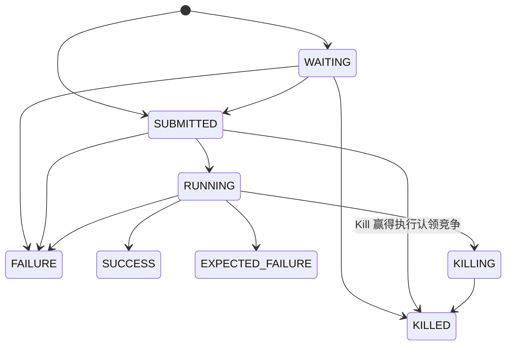

# FlowRun 状态机与分布式状态仲裁设计（简化中文版）

> **状态：** 历史设计。当前实现与发布说明见
> [状态机迁移文档](flow-run-state-machine-migration.md)，创建路径见
> [单阶段创建文档](flow-run-single-phase-creation.md)。
>
> **英文详细版：** [flow-run-state-machine.md](flow-run-state-machine.md)
>
> **范围：** `t_job_flow_run` 中除 `JOB_LIST` 以外的生命周期。生产中的 `JOB_LIST`
> 暂时保留独立 legacy 路径，等待后续迁移；本次只补充 FlowRun Kill 正确性必需的最小
> JobRun 启动/Kill 栅栏，不重做完整 JobRun 状态机。
>
> 本文是便于评审的简化中文版。实现时以两份文档中已经确认的共同规则为准；后续设计
> 变更必须同步更新两份文档。

## 一、为什么需要统一状态机

目前有多个组件直接修改 `t_job_flow_run.status`：

| 写入者 | 典型状态变化 | 当前问题 |
|---|---|---|
| `FlowScheduleService` | `WAITING → FAILURE` | 自己处理 CAS 失败和重读 |
| `FlowRunCoordinator` | `WAITING → SUBMITTED/FAILURE` | 自己判断竞争结果 |
| `KillJobService` | 未终态 → `KILLING/KILLED` | 部分路径按 ID 无条件覆盖 |
| `FlowExecuteThread` | `SUBMITTED → RUNNING → 终态` | 部分路径按 ID 无条件覆盖 |
| 其他失败、恢复和通用更新接口 | 多种状态 | 可以绕过状态机 |

问题不只是 Scheduler 与 Dispatcher 两个函数之间的竞态。系统现在已经有多个状态
写入者；继续在每个调用方里增加 `if/else`、CAS 重试和特殊判断，复杂度会持续增长。

设计目标是：

- 除隔离的 `JOB_LIST` legacy 路径外，所有 FlowRun 状态变化通过统一入口；
- 数据库负责多实例之间的原子竞争；
- 业务代码拿到结构化结果，而不是只拿到 `true/false`；
- Kill、执行完成、依赖推进和超时之间有明确优先级；
- 所有状态协调和数据库重试都有明确上限。

## 二、核心原则

1. **终态不可修改。** `SUCCESS/FAILURE/KILLED/EXPECTED_FAILURE` 等终态提交后，不再自动
   转换到其他状态。
2. **`KILLING` 是栅栏。** 一旦进入 `KILLING`，Scheduler、Dispatcher 和执行线程都不能
   再把它推进为正常运行或完成状态。
3. **Kill 只抢占未完成工作。** Kill 先提交就阻止正常完成；正常终态先提交，后来的
   Kill 返回“已经结束”，不能改写历史。
4. **每次更新必须声明来源状态。** 禁止生产代码只按 ID 无条件写 status；执行方的
   完成写入还必须声明预期 host，旧 Worker 不能完成已经转移给新 Worker 的实例。
5. **一次性副作用只由赢家执行。** 只有成功完成状态转换的一方才能发送终态告警或
   发布完成结果。
6. **Kill 清理允许重试。** `KILLING` 已经是持久化意图，任何 Worker 都可以继续执行
   幂等清理。
7. **重试分层且有界。** 每个目标行每次业务操作最多一次 CAS 和一次协调重读；数据库
   瞬时错误由外层业务事务最多尝试 3 次，状态服务自身不重试整个事务；Kill 清理由
   后台异步重试。
8. **Kill 先关闭启动栅栏再清理。** 第一次查询不到 JobRun 不代表之后不会启动资源。
   `KILLING` 提交后必须阻止新的 JobRun 预留和外部启动认领；所有已经通过栅栏的子任务
   停止或确认不存在后，才能写入 `KILLED`。

首阶段不新增 owner generation，也不承诺网络分区下外部任务严格 exactly-once 启动；
它保证旧 Worker 不能发布 FlowRun 终态，并由新 Owner 持续清理到收敛。

## 类型模型与 legacy 边界

生命周期合同属于 `t_job_flow_run`，不属于某个具体 `JobFlowType`，状态核心内部不按类型
分支：

- 未来的 `FLINK/SPARK/SQL` 在定义层是 `t_job_flow` 与 `t_job` 1:1，运行层也是一个
  FlowRun 对应一个 JobRun；
- 当前 `JOB_FLOW`、未来改名后的 `FLOW` 是组合型特例：定义层一个 Flow 关联多个 Job，
  运行层一个 FlowRun 对应多个 JobRun；
- 具体执行适配器负责创建子任务和汇总终态；
- 只有 `JOB_LIST` 在生产迁移完成前绕过新合同，继续走隔离的 legacy 路径。

因此新增 1:1 类型或把 `JOB_FLOW` 改名为 `FLOW` 都不需要修改状态核心。legacy 路径不再
新增能力，也不能把 `JOB_LIST` 判断带进新状态代码。

## 三、状态流转

新 FlowRun 在准入事务中以完整快照和 `WAITING` 或 `SUBMITTED` 状态入库。
`ExecutionStatus.CREATED` 仍用于 JobRun；历史 FlowRun 记录可能保留该状态，
但新的 FlowRun 创建路径不会再生成它。



### 允许的转换

| 来源状态 | 目标状态 | 业务含义 |
|---|---|---|
| `WAITING` | `SUBMITTED` | 依赖满足 |
| `WAITING` | `FAILURE` | 依赖超时、不可满足或配置错误 |
| `WAITING` | `KILLED` | 等待期间取消 |
| `SUBMITTED` | `RUNNING` | 执行线程成功认领 |
| `SUBMITTED` | `FAILURE` | 无法启动执行 |
| `SUBMITTED` | `KILLED` | Kill 在执行线程认领前赢得 CAS |
| `RUNNING` | `SUCCESS/FAILURE/EXPECTED_FAILURE` | 正常执行完成 |
| `RUNNING` | `KILLING` | 请求停止外部资源 |
| `KILLING` | `KILLED` | 外部资源已经停止 |

明确禁止：

- `SUBMITTED → SUCCESS/EXPECTED_FAILURE`：执行必须先成功认领 `RUNNING`；
- `KILLING → RUNNING/SUCCESS/FAILURE`；
- 任意终态重新回到活动状态；
- Retry 把原终态记录重新改成活动状态，Retry 应创建新 attempt。

## 四、Kill 的业务语义

### `WAITING`

该状态没有已经启动的执行资源，可以直接 CAS 到 `KILLED`。历史遗留的 FlowRun
`CREATED` 记录也可直接取消，但不会再激活。

### `SUBMITTED`

`SUBMITTED` 是执行认领边界：

```text
Executor: SUBMITTED → RUNNING
Kill:     SUBMITTED → KILLED
```

两个操作通过数据库 CAS 竞争：

- Executor 赢：状态进入 `RUNNING`，Kill 随后必须走 `RUNNING → KILLING`；
- Kill 赢：状态直接进入 `KILLED`，Executor 不允许启动资源。

因此必须保证执行线程先成功写入 `RUNNING`，再创建外部执行资源。

### `RUNNING`

普通 Kill 请求先执行：

```text
RUNNING → KILLING → KILLED
```

步骤：

1. CAS 把 `RUNNING` 改为 `KILLING`；
2. 提交事务，建立持久化栅栏；
3. 在事务外停止本地或远程资源；
4. 资源停止或确认不存在后，CAS 为 `KILLED`；
5. 清理失败则保留 `KILLING`，由其他 Worker 重试。

即使清理看起来很简单，`RUNNING` 也必须先进入 `KILLING`，关闭后续启动入口。
清理完成或确认资源不存在后，`confirmKilled` 只执行 `KILLING → KILLED`。

请求线程不能因为第一次查询不到 JobRun 就直接确认 `KILLED`。子任务使用两道持久化
启动栅栏：

1. 短事务锁定父 FlowRun，校验 `RUNNING + expectedHost` 后才创建或复用 JobRun；
2. 外部命令启动前，JobRun 必须赢得条件认领，Job Kill 与这个认领竞争。

预留先提交时，JobRun 会在父流程进入 `KILLING` 前持久化可见；Kill 先提交时，后续预留
看到 `KILLING` 后不创建任务。只有所有可见 JobRun 都完成或失去启动认领，并确认外部
资源已经停止，才能完成父 FlowRun。具体 JobRun 状态边在后续启动栅栏任务中确定，本文
不扩成第二套完整状态机。

故障转移时 host 更新必须同时校验旧 host 和未终态；执行完成 CAS 也必须携带本机 host。
因此旧 Worker 即使晚到，也不能提交 FlowRun 的最终结果。

### Kill 与执行完成同时发生

```text
Executor: RUNNING → SUCCESS
Kill:     RUNNING → KILLING
```

- `SUCCESS` 先提交：Kill 得到 `REJECTED + SUCCESS`，按幂等无操作处理；
- `KILLING` 先提交：Executor 的完成 CAS 失败，不能发送成功告警；
- 不允许失败方覆盖赢家。

## 五、统一状态转换服务

### 包与依赖边界

FlowRun 生命周期代码从扁平的 `web.service` 中拆出，按领域集中：

```text
com.flink.platform.web.flowrun
├── FlowRunStateService
├── FlowRunTransition
├── FlowRunAdmissionService
└── FlowRunKillService
```

`FlowRunStateService` 只负责合法转换和结果解释；准入、Kill 服务负责编排事务与外部
副作用。Quartz、Controller、Dispatcher 和 Executor 只能调用该包，不能自行实现转换
规则；DAO 原语仍留在 `flink-platform-dao`。

包名表达 FlowRun 领域，不绑定通用状态机框架。`JOB_LIST` 在进入该包之前就路由到已有
legacy 处理器，并暂时从架构检查中显式豁免。

### DAO 层：只提供原子更新

`JobFlowRunService` 只负责条件更新和轻量读取，不负责业务判断：

DAO 只需要状态条件更新、Owner 条件转移和轻量读取，具体方法签名在对应任务中评审：

- 按预期 status、可选预期 host 更新目标状态；
- 供故障恢复按旧 host 和未终态条件原子转移 Owner；
- 只读取 status、host 和生命周期时间。

`expectedHost` 对准入和 Kill 可以为空；首次执行、完成和故障转移相关写入必须提供 host。
`updateHostsIfOwnedBy` 只更新候选 ID 中 host 仍是观察到的故障节点、且状态未终结的记录。
`WorkerHeartbeat` 按目标 host 分组并分块提交，记录请求数和实际更新数；后续动作不依赖
逐条获胜结果。该更新不修改生命周期状态和时间字段。

`findState` 只读取 status、host 和生命周期时间。只有记录确实不存在时才返回空；不能像
现有尽力恢复查询一样吞掉数据库异常，否则会把基础设施故障误判成 `NOT_FOUND`。

`FlowRunCreationService` 在一次准入事务中插入完整运行快照，初始状态为
`WAITING` 或 `SUBMITTED`；准入被阻止时不插入记录。

同一条 SQL 同时处理状态对应的时间字段：

- 进入 `RUNNING` 时设置 `start_time`；
- 进入终态时设置 `end_time`；
- 进入 `KILLING` 时不设置 `end_time`。

### 领域层：`FlowRunStateService`

这是一个无状态 Spring Service，每个应用实例都有一份；它不使用 JVM 锁，真正的
分布式仲裁者是共享数据库。公开操作按业务命名，覆盖等待推进/失败、
首次执行/完成、Kill 请求/确认和人工确认。Owner 转移由 `WorkerHeartbeat` 编排，
直接调用 DAO 的条件更新；它不改变流程运行状态。调用方不能自由拼装来源状态和
目标状态。具体 Java 类型和方法签名在 Phase 1 任务中确定。

### 返回结果

| 结果 | 含义 | 调用方处理 |
|---|---|---|
| `APPLIED` | 本次转换成功，`status` 是目标状态 | 执行赢家副作用 |
| `REJECTED` | 其他状态先提交，`status` 是协调重读结果 | 统一解释当前状态 |
| `NOT_FOUND` | 运行实例不存在，`status` 为空 | 明确失败 |

`REJECTED` 不再拆成多个枚举：

- `status == targetStatus`：只有明确声明可重复的操作才按幂等成功处理；
- `status.isTerminalState()`：保留已经提交的终态；
- 其他未终态：本次操作被抢占，由领域方法决定 BLOCKED、协调或继续清理。

非法参数属于编程错误，例如 `completeExecution(..., KILLED)`，在执行 SQL 前直接抛出，
不再为此增加新的运行时结果枚举。

FlowRun id 和目标状态已经是方法参数，不再在结果里重复。MySQL 没有与 PostgreSQL
完全等价的通用 `UPDATE ... RETURNING`。因此 CAS 更新 0 行后，服务最多再读取一次
当前状态。这个状态用于诊断和业务协调，不宣称是 CAS 失败瞬间的
线性一致快照。方法名就是日志和指标中的操作类别；具体失败、超时和告警原因继续由
调用方携带，不新增通用原因枚举。

`requestKill` 先轻量读取一次状态，再选择 `WAITING/SUBMITTED → KILLED`（历史遗留
`CREATED` 记录也可直接取消）或 `RUNNING → KILLING`，随后只执行一次 CAS；竞争失败后
最多再协调读取一次，不依次尝试多个目标。直接取消的 CAS 接受 `CREATED/WAITING/SUBMITTED`
三个尚未开始执行的状态，因此读取后发生 `WAITING → SUBMITTED` 也不会使取消失败。
`confirmKilled` 只供关闭子任务启动栅栏并完成资源确认后的清理流程使用；
`forceKilled` 是有审计的人工确认，两者都不能改写已经存在的终态。
带 worker host 参数的 `requestKill` 重载只允许当前归属 worker 执行 `RUNNING → KILLING`；
若 host 条件竞争失败，不回退到无 host 条件的重载。

## 六、多实例为什么可行

所有实例执行同一条条件更新：

```sql
UPDATE t_job_flow_run
SET status = :target
WHERE id = :id
  AND status IN (:expected_statuses);
```

```text
Instance A ─┐
            ├─ 共享数据库行级竞争 → 只有一个更新成功
Instance B ─┘
```

- 更新 1 行：当前实例是赢家；
- 更新 0 行：其他实例已经改变状态；
- 事务回滚：状态转换没有生效，其他实例仍可继续竞争。

正确性不依赖 `synchronized`、本地缓存或固定主节点。SQL 形状同时兼容 MySQL 和
PostgreSQL，也不依赖 PostgreSQL 专用 `RETURNING` 或 MySQL gap lock。

首次执行和恢复必须分开：只有成功执行 `SUBMITTED → RUNNING` 的赢家可以首次启动；
已经是 `RUNNING` 的记录只能由持久化 host 对应的 Worker 原地恢复，不能把
`RUNNING → RUNNING` 伪装成幂等状态转换。完成时同时校验 `status = RUNNING` 和本机
host；故障转移只在 host 仍是故障节点且状态未终结时更新 host。

## 七、重试策略

需要区分三种完全不同的重试：

1. **正常状态竞争：** 每个目标行执行一次 CAS，失败后最多重读该行一次。活动实例数
   本来就有上限，首阶段优先选择这个简单合同，不新增批量结果封装。CAS 被拒绝是正常
   协调，不记为任务失败或系统错误。
2. **数据库瞬时故障：** 死锁、序列化失败或可重试连接异常，可以在事务外最多重试
   2 次，即最多尝试整个事务 3 次，并使用短暂随机退避；每次必须开启新事务并重新
   读取状态。重试由外层业务操作负责，`FlowRunStateService` 不重试调用方事务或外部
   副作用；业务拒绝不由这一层重试。
3. **Kill 外部清理：** `KILLING` 已经持久化，由后台协调器持续幂等重试，不阻塞请求
   或准入事务。

这样既能减少定时调度因为数据库瞬时问题产生的系统失败，也不会用多次 CAS 掩盖状态
机错误。正常 CAS 竞争经过有界重读后：活动赢家使准入 BLOCKED，终态赢家允许继续；
Quartz occurrence 只有在可重试事务全部耗尽后才报告数据库失败；仍无法解释的状态或
重试耗尽才算系统问题。

## 八、准入流程使用有界协调

`FlowRunCreationService#tryCreateFlowRun` 保留 flow 定义行锁，用于串行化同一个 flow 的
实例创建；状态竞争交给统一状态服务。当前实现已经没有无界循环，实际迁移内容是把
CAS 失败时直接抛异常改为有界协调。

新的有界流程：

1. 锁定 `t_job_flow` 定义行；
2. 读取当前活动实例；
3. 非过期活动实例按现有并发规则判断冲突；
4. 对过期 WAITING 执行一次 `WAITING → FAILURE` CAS；
5. 全部 `APPLIED`，或被已提交终态 `REJECTED`：继续创建；
6. 被其他未终态 `REJECTED`：只重新读取一次活动实例；
7. 最新状态是 `SUBMITTED/RUNNING/KILLING`：本次准入 BLOCKED；
8. 最新状态都是终态：允许创建；
9. 重读后仍出现无法解释的过期 WAITING：快速失败并报告状态机约束被破坏。

每个过期目标行只 CAS 一次；整个准入最多重新查询一次活动实例集合。单个转换结果仍
可按统一合同执行一次诊断读取，但不会等待外部状态无限变化。

### 子流程创建

子流程与定时、手动触发共用准入事务。准入冲突返回 `BLOCKED`，不写子流程记录；
准入成功时一次性插入完整快照，并把子流程 id 与初始状态返回给父任务回调。

## 九、调用方迁移

### `FlowRunCoordinator`

- `WAITING → SUBMITTED/FAILURE` 改用状态服务；
- 只有 `APPLIED` 才发送对应终态告警；
- CAS 失败不在本地无限重试，赢家已经接管该实例。

### `KillJobService`

- 删除无条件 `updateStatusById`；
- `WAITING → KILLED`；历史遗留的 `CREATED` 记录也可直接取消；
- `SUBMITTED → KILLED` 与 Executor 认领竞争；
- 普通 `RUNNING → KILLING`；
- `KILLING/KILLED` 作为幂等成功；
- 其他终态返回 `REJECTED + status`，并保持不变；
- 请求可以启动尽力清理，但不能根据一次空 JobRun 查询同步确认仍在执行的 FlowRun。

### `FlowExecuteThread`

- 首次启动前必须成功执行 `SUBMITTED → RUNNING`；
- 已经是 `RUNNING` 的实例只允许持久化 host 对应的 Worker 走明确恢复分支；
- 被 `KILLING/KILLED` 抢占后不能启动资源；
- 调度每个新节点前重新检查持久化 status 和 host；
- 完成时只允许 `RUNNING → SUCCESS/FAILURE/EXPECTED_FAILURE`；
- 完成 CAS 必须带本机 host，旧 Owner 不能完成已经转移的实例；
- Kill 已经赢得竞争时，不覆盖状态，也不发送普通完成告警。

### 类型路由

- `JOB_LIST` 在调用 `web.flowrun` 前进入原 legacy handler；
- 其他当前及未来类型统一使用生命周期合同；
- 类型判断只存在于路由边界，`FlowRunStateService` 内部不允许按类型分支。

### 通用更新接口

通用 FlowRun 更新接口禁止修改 `status/startTime/endTime`。生命周期操作必须使用明确
的业务接口，避免绕过状态机。

当前 UI 的 “Set KILLED” 通过 `POST /jobFlowRun/update` 直接写 status。迁移时新增有审计
的人工确认操作并先迁移 UI；旧的精确请求 `{id, status: KILLED}` 保留一个版本作为
兼容适配，内部转发到同一领域方法。其他生命周期字段立即拒绝。适配层保持 HTTP 形状，
但不再允许把已经提交的 `SUCCESS/FAILURE` 改写为 `KILLED`。

### 恢复与故障转移

任何恢复组件只要需要写 FlowRun 状态，也必须使用同一个转换服务。不同 Worker 可以
观察并继续处理 `KILLING`，不要求原 Worker 存活。`WorkerHeartbeat` 转移 host 时必须
校验旧 host 和未终态；新 Owner 对 `RUNNING` 走恢复分支，对 `KILLING` 只走清理分支。

## 十、数据库状态与外部副作用

进程终止、Quartz 和告警都不能与数据库状态处于同一个事务，因此统一采用：

1. 先持久化状态所有权或意图；
2. 提交事务；
3. 执行外部副作用；
4. 使用下一次条件转换持久化最终结果。

示例：

```text
RUNNING → KILLING（提交）
停止外部资源
KILLING → KILLED（提交）
```

等待超时或执行完成的告警也只能在相应终态提交后发送。首阶段不引入 outbox；如果
未来要求通知严格一次，再单独设计事务消息。

## 十一、`KILLING` 恢复

系统需要周期性处理 `KILLING`：

1. 只由持久化 Owner host 执行，或先通过条件更新完成孤儿转移；
2. 依靠已提交的父状态拒绝后续所有子任务预留事务；
3. 让每个已存在 JobRun 完成或失去外部启动认领；
4. 查询全部已准入的 job/infrastructure 标识并幂等重试终止操作；
5. 所有子任务已终结且资源停止或不存在后写 `KILLED`；
6. 仍有认领、资源或 Owner 变化未解决时保持 `KILLING`；
7. 清理失败不能恢复正常执行。

首阶段可以每次协调周期重试，不能因为超时或第一次资源查询为空就强制 `KILLED`。
若以后需要“处于 KILLING 多久”的持久化告警，应增加 `kill_requested_at` 或通用状态
变更时间字段；首阶段不为此改表。

## 十二、API 语义

Kill API 必须幂等：

| 当前状态 | API 结果 | 状态影响 |
|---|---|---|
| `WAITING`（或历史遗留 `CREATED`） | 已完成 | `KILLED` |
| `SUBMITTED` | Kill 赢认领竞争时已完成 | `KILLED` |
| `RUNNING` | 已接受 | `KILLING` |
| `KILLING` | 已在处理中 | 不重复状态转换，可重试清理 |
| `KILLED` | 已经完成 | 无变化 |
| 其他终态 | 已经结束 | 无变化 |
| 不存在 | NOT_FOUND | 无变化 |

Controller 不再先查状态、再无条件写入，而是直接使用状态转换结果生成响应。

## 十三、日志与监控

正常的 `REJECTED` 竞争使用 debug/info 日志，不计入任务失败或系统错误。以下情况才是
warning/error：

- 已知 run 返回 `NOT_FOUND`；
- 领域方法收到非法参数；
- 一次协调重读后状态仍无法解释；
- 数据库瞬时异常在 3 次事务尝试后仍然失败。

建议统计：

- 按领域操作和目标状态统计 `APPLIED`；
- 按协调后的 `status` 统计 `REJECTED`；
- 数据库事务重试次数和重试耗尽次数；
- `KILLING` 清理失败次数；
- 准入状态机约束异常次数。

## 十四、测试要求

### 单元测试

- 参数化覆盖全部允许和禁止的状态边；
- 终态不可退出；
- `KILLING` 栅栏不可绕过；
- 领域方法只能产生各自允许的状态边；
- 只有赢家设置时间字段和发送一次性副作用。

### 竞态测试

- 子流程准入成功时写入完整快照，被阻止时不留下子流程记录；
- 依赖满足与等待超时；
- WAITING 超时与 Kill；
- Executor 认领与 SUBMITTED Kill；
- 首次认领与同 host 的 `RUNNING` 恢复；
- 孤儿转移后旧 host 的完成回调；
- RUNNING 完成与 Kill，两种提交顺序都覆盖；
- 重复 Kill；
- 子任务预留与父 `RUNNING → KILLING` 的两种提交顺序；
- JobRun 启动认领与 Job Kill 的两种提交顺序；
- 两道启动栅栏未关闭前，空清理快照不能确认 `KILLED`；
- Kill 后迟到的执行完成回调；
- 无法协调的状态快速失败，不出现无限循环；
- 正常 CAS 被拒绝不记录为任务或系统失败；
- 可重试数据库异常最多尝试整个事务 3 次；
- 业务拒绝和不可重试异常不执行事务重试；
- 所有非 `JOB_LIST` 类型共享状态合同，`JOB_LIST` 只能走 legacy 路由；
- 旧 `{id, status: KILLED}` 适配进入有审计的管理操作，已有终态保持不变。

### 真实数据库测试

使用 MySQL 和 PostgreSQL Testcontainers 运行相同的双连接测试：

- 两个事务从同一状态开始竞争；
- 最终只有一个 CAS 成功；
- 失败方正确识别赢家状态；
- `KILLING` 和终态不能被覆盖；
- host 转移后，携带旧 host 的完成 CAS 必须失败；
- 被阻止的子流程准入不能留下空壳记录；
- 子任务预留与父 Kill 必须通过父记录行锁串行化；
- 两种数据库产生一致的业务结果。

仅靠 Mockito 不能证明事务隔离、行锁和 affected rows 行为。

## 十五、实施阶段

### Phase 1：状态转换合同

- 创建 `web.flowrun`，新增状态矩阵、简化结果和薄 `FlowRunStateService`；
- 新增三个条件写入 DAO 原语；
- 保留现有 status 字段和枚举值；
- 增加单元测试和 MySQL/PostgreSQL CAS 集成测试；
- 暂不迁移调用方。

### Phase 2：准入与 Dispatcher

- 迁移 `FlowScheduleService`、`FlowRunCoordinator`；
- 把准入 CAS 失败直接抛异常改为有界协调；
- 在准入事务中一次性插入子流程完整快照；
- 对明确可重试的数据库异常增加最多 3 次事务尝试（首次加 2 次重试）；
- 保留事务提交后的单赢家超时告警。

### Phase 3：FlowRun 执行所有权

- 迁移 `FlowExecuteThread` 的首次启动、恢复和完成；
- 分离首次认领与同 host 恢复；
- 完成与孤儿转移增加 host 栅栏。

### Phase 4：FlowRun Kill 意图与协调

- 拆分 FlowRun Kill 编排和 JobRun Kill 实现；
- 实现 Kill 幂等和 `KILLING` 栅栏；
- 先完成 FlowRun 侧协调，最终确认留到 JobRun 启动栅栏任务。

### Phase 5：最小 JobRun 启动/Kill 栅栏

- 子任务预留与父 `RUNNING/KILLING` 边界串行化；
- 外部任务启动使用条件认领，Job Kill 与该认领竞争；
- 所有已准入 JobRun 停止或不存在后，才允许父流程进入 `KILLED`；
- 不重做无关的 JobRun 重试、监控和终态汇总逻辑。

### Phase 6：关闭旁路并保持 API 兼容

- 废弃无限制状态更新方法并迁移故障恢复路径；
- 新增有审计的人工确认操作并迁移 UI；
- 通用 API 禁止写生命周期字段，只临时保留 `{id, status: KILLED}` 兼容适配；
- 增加架构测试，确保生产状态写入只能经过统一入口；隔离的 `JOB_LIST` legacy handler
  暂时进入明确 allow-list。

### Phase 7：运行保障与启用

- 增加状态转换指标；
- 压测 Dispatcher 批量转换；
- 根据实际需要决定是否增加状态历史、Kill 时间字段或事务 outbox。

前六阶段不要求修改 FlowRun 表结构，不修改状态码和响应形状。采用桥接版本平滑上线：

1. 新增默认关闭的 `worker.flow-run-lifecycle-enabled`；
2. 迁移后的调用方只调用状态服务，兼容分支集中在该 facade；关闭时转发给保留的旧
   helper，不把开关判断散落到各调用方；
3. 开关关闭时先滚动升级所有 Worker，期间继续使用旧语义；
4. 确认全集群都是桥接版本后，短暂停止生命周期写入，全集群启用开关并核验，再恢复；
5. 旧 helper 和管理适配保留并废弃一个版本，确认没有外部使用后再删除。

开关启用后，`JOB_LIST` 仍继续走隔离的 legacy handler；所有其他已支持类型使用新合同。
删除这个例外需要单独迁移生产定义和历史数据，但它不阻塞新增 `FLINK/SPARK/SQL`，也不
阻塞把 `JOB_FLOW` 改名为 `FLOW`。

旧二进制仍能无条件写状态时，任何新代码都无法完整保证栅栏。因此启用阶段不能长期
混跑；不具备桥接开关与集群核验能力时，使用协调停机发布作为更简单的备选方案。

## 十六、不采用的方案

- **把全部规则塞进 `JobFlowRunService`：** 少一个类，但会把合法业务操作与通用 CRUD
  混在一起。当前方案只保留一个薄领域服务和三个条件写入原语，已经是最小有效分层。
- **通用状态机框架或数据库触发器：** 前者增加第二套转换描述，后者增加数据库方言和
  隐式业务行为；当前状态数量不值得这些成本。
- **JVM `synchronized`：** 只能保护单实例。
- **所有写入者都锁 flow 行：** 锁过粗，Dispatcher、Kill 和完成回调会互相阻塞。只在
  两个准入边界使用短锁：创建 FlowRun 时锁定义行，预留 JobRun 时锁父 FlowRun 行；
  轮询、完成和普通转换仍使用 CAS。
- **无条件更新加状态优先级：** last-write-wins 会改写已经完成的历史。
- **所有 CAS 失败都直接失败：** 安全但可能丢失本来可以创建的 cron occurrence。
- **首阶段直接事件溯源：** schema、投影和恢复成本过高。

## 十七、完成标准

- 所有非 `JOB_LIST` 生产 FlowRun 状态写入都经过统一转换合同；
- 准入被阻止时不留下不完整的 FlowRun 记录；
- `KILLING` 和终态不能被普通执行覆盖；
- host 转移后旧 Worker 不能提交终态；
- Kill 幂等并能跨 Worker 恢复；
- Kill 只有在子任务预留和启动栅栏关闭并确认资源清理后才完成；
- 准入逻辑不存在无界重试；
- 正常 CAS 竞争不记录为任务或系统失败；
- 数据库瞬时异常只进行有限的整个事务重试；
- 只有转换赢家发送一次性副作用；
- MySQL/PostgreSQL 并发测试业务结果一致；
- 通用 API 不能修改生命周期字段；
- 状态核心不包含类型分支，`JOB_LIST` 是唯一记录在案的 legacy 旁路；
- 旧管理适配不能改写已有终态；
- 发布说明包含桥接开关、启用门禁和新旧 Worker 混跑限制。

## 参考设计

- [Temporal：取消与终止](https://docs.temporal.io/develop/java/cancellation)
- [Prefect：取消工作流](https://docs.prefect.io/v3/advanced/cancel-workflows)
- [Kubernetes：Finalizers](https://kubernetes.io/docs/concepts/overview/working-with-objects/finalizers/)
